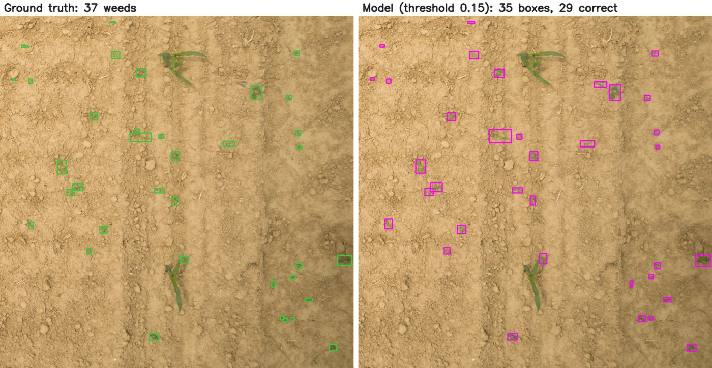
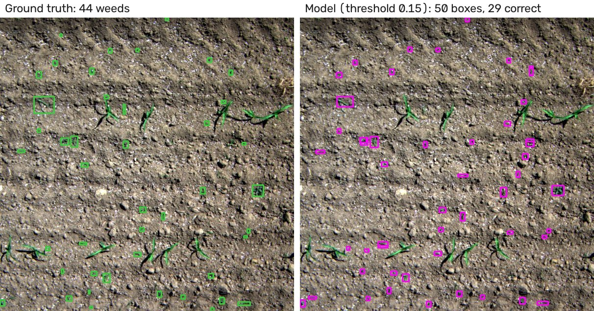
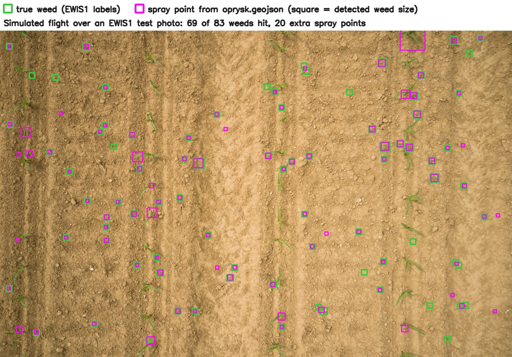

# FIELDEYE — AI software for weed detection from drone images

This repository is **only the AI-related software part** of the FIELDEYE project: the data,
the weed detection model, its deployment on the drone's AI accelerator and the program that
turns detections into spray coordinates, plus the simulator used to test all of it without a
drone. The drone itself, its electronics and the integration on board are not part of this
repository.

In the drone system this software is an **external module that runs on the Raspberry Pi**
(with the Hailo-8 accelerator) that will be mounted on the drone, next to the drone's own
systems and not inside the flight controller. The drone's side gives it photos and telemetry through a folder;
it gives back the spray map.

---

## About the FIELDEYE project

FIELDEYE is a student PBL (project-based learning) project at the Silesian University of
Technology (Politechnika Śląska). The idea: a drone flies over a crop field at about 5 m, a
camera photographs the field, and every photo is checked for weeds **during the flight**.
Each detected weed gets GPS coordinates, so the farmer receives a map of the places that need
spraying instead of spraying the whole field.

| | |
|---|---|
| drone computer | Raspberry Pi 5 with the AI HAT+ (Hailo-8 accelerator, 26 TOPS) |
| camera | Arducam 64MP Hawkeye, pointing straight down, flight altitude about 5 m |
| telemetry | autopilot writes a GeoJSON file (position, heading, altitude, tilt) next to every photo |
| result for the farmer | spray points as GeoJSON / CSV (coordinates, radius, confidence) |

Where this software sits in the drone system:

```
 DRONE                                  RASPBERRY PI 5 TO BE MOUNTED ON THE DRONE (+ AI HAT+, Hailo-8)
 ─────                                  ─────────────────────────────────────────────────────────────
 autopilot, GPS / IMU  ──┐              drone-side software (embedded subgroup):
 camera                ──┴────────────► camera capture + telemetry writer
                                                    │
                                                    ▼  photo folder: IMG.jpg + IMG.geojson
                                        THIS REPOSITORY — external module: fieldeye-detect
                                        weeds on every photo → coordinates → spray points
                                                    │
                                                    ▼
                                        spray map (GeoJSON / CSV) → farmer / sprayer
```

The team works in three subgroups:

| Subgroup | Responsibility | In this repository |
|---|---|---|
| **AI / ML** | datasets, weed detector, model compilation for Hailo-8, detection program, simulator | **yes — everything here** |
| embedded | drone hardware, Raspberry Pi and camera, telemetry, running the program on board | no — the shared interface is a photo folder + GeoJSON telemetry |
| organisational | organisation of the project | no |

---

## What it looks like

**Detection.** The final model on a test tile it never saw in training (EWIS1, flight day
16 May 2022). Left: weeds marked by the dataset authors; right: the model's boxes
(confidence threshold 0.15). The tile was not hand-picked: it is the one whose F1 score is
closest to the median over all test tiles with at least 20 weeds, so it shows a typical result.



The same for WeedsGalore, the hardest test set (very young seedlings, only a few pixels wide):



**Spray map.** A simulated flight: `mission.drone_sim` flies over one EWIS1 test photo (about
6.4 × 4.3 m of field, 1.5 × 1.5 m per drone photo) and writes photos + telemetry;
`fieldeye-detect` turns them into spray points. Compared with the true weed positions (a hit is
a spray point closer than 10 cm): 69 of 83 weeds hit, 20 extra spray points (perfect telemetry,
no GPS error).



Green: true weeds seen on the flight photos (EWIS1 labels). Pink: spray points from
`oprysk.geojson`, each drawn as a square the size of the detected weed (spray radius minus the
5 cm margin). Pink inside green = weed hit; green alone = weed missed; pink alone = extra spray
point. The picture was made for this README from the EWIS1 labels and `oprysk.geojson`;
`fieldeye-detect` itself only writes the GeoJSON.

The spray map from this flight, exactly as `fieldeye-detect` writes it (`oprysk.geojson`;
GitHub shows it on a map, click a point to see its radius and confidence):
[`docs/example/oprysk_simulated.geojson`](docs/example/oprysk_simulated.geojson).
**Its coordinates are made up:** the photo was placed at an arbitrary point (top-left corner
50.255150, 19.033382) only so that it can be drawn on a map. They are not where the photo was
taken; only the distances between points are real.

Images: [EWIS1](https://doi.org/10.17632/6j5pxgf437.1) (N. Genze, M. Grieb, D. Grimm, CC BY 4.0)
and [WeedsGalore](https://doidata.gfz.de/weedsgalore_e_celikkan_2024/) (E. Celikkan et al., CC BY),
cropped, resized and annotated with our model's detections. Full citations:
[Datasets and licences](#datasets-and-licences).

---

## What the software consists of

| # | Component | Folder | Input → output |
|---|---|---|---|
| 1 | **Data normalization** — reads public weed datasets (each in its own format), unifies class names, removes duplicates, splits without leaks, cuts tiles at the drone's scale | [`normalization/`](normalization/README.md) | raw datasets in `dane/` → YOLO datasets `zbior_*/` |
| 2 | **AI model** — YOLOv8n weed detector: training plan, training, evaluation per flight day, test-time augmentation | [`models/`](models/README.md) | YOLO datasets → `models/weights/fieldeye_final.pt` + results |
| 3 | **Edge deployment (Hailo-8)** — export to ONNX, calibration images, INT8 compilation to `.hef`, accuracy check on the Pi | `models/export.py`, [`scripts/HAILO.md`](scripts/HAILO.md) | `.pt` → `.onnx` → `fieldeye_final_1280_h8.hef` |
| 4 | **In-flight detection and spray map** — `fieldeye-detect`: watches the photo folder, detects weeds tile by tile, converts them to coordinates using the telemetry, merges them into spray points; also as a single-file binary | [`mission/`](mission/README.md), [`docs/fieldeye-detect.md`](docs/fieldeye-detect.md) | photos + GeoJSON telemetry → spray map (GeoJSON / CSV) |
| 5 | **Flight simulator and mosaic** — cuts one large image into drone frames with realistic disturbances, stitches frames into a mosaic, drone camera model; simulated drone that writes photos + telemetry | [`stitchlive/`](stitchlive/README.md), `mission/drone_sim.py` | field image → frames + ground truth → mosaic |
| 6 | **GUI** — Streamlit app for trying the simulator, the stitching and the detector | `app.py` | browser interface |
| 7 | **Automation and tests** — one script for the whole model, binary build, Pi package; ~215 tests | [`scripts/`](scripts/README.md), [`tests/`](tests/README.md) | — |

---

## Overall pipeline

```
 PUBLIC DATASETS                    TRAINING (Mac / PC)                         DEPLOYMENT
 ───────────────                    ───────────────────                         ──────────
 WeedsGalore (drone) ─┐
 Sudars (ground)     ─┼─► normalization/  ─► models/          ─► models/weights/fieldeye_final.pt
 EWIS1 (drone, RGB)  ─┘   formats → YOLO      train, evaluate          │
                          dedup, split,       per flight day,          ├─► ONNX + calibration images (models/export.py)
                          tiles 896 px        TTA, threshold 0.15      │        │
                                                                       │        ▼  scripts/compile_hef.py (Linux x86 / WSL)
                                                                       │   fieldeye_final_1280_h8.hef (Hailo-8)
                                                                       │        │
 DRONE                                                                 ▼        ▼
 photo + telemetry (.geojson) ─────────────────────────────► mission/ fieldeye-detect (binary on the Pi)
                                                               tiles → model → GPS coordinates
                                                               → spray map (GeoJSON)

 LAPTOP TOOLS
 stitchlive/  flight simulator (cuts one big image into drone frames), mosaic stitching, camera model
 app.py       Streamlit GUI: split an image into frames, stitch them, simulated flight with detection
```

`scripts/final_model.sh` runs the whole training side in one go: normalization of the three
datasets → training → evaluation on two test sets → ONNX package for the Hailo compiler.

### How each part works inside

| Part | Flow, technologies and key functions explained |
|---|---|
| data normalization | [`normalization/PIPELINE.md`](normalization/PIPELINE.md) |
| AI model | [`models/PIPELINE.md`](models/PIPELINE.md) |
| Hailo-8 deployment | [`scripts/HAILO_PIPELINE.md`](scripts/HAILO_PIPELINE.md) |
| in-flight detection and spray map | [`mission/PIPELINE.md`](mission/PIPELINE.md) |
| flight simulator and mosaic | [`stitchlive/PIPELINE.md`](stitchlive/PIPELINE.md) |
| GUI | [`docs/gui.md`](docs/gui.md) |

---

## Final model

`models/weights/fieldeye_final.pt` — YOLOv8n, one class (`chwast` = weed), input 1280 px,
trained on WeedsGalore (early-season days oversampled) + Sudars + EWIS1 maize (1866 tiles).
Run with test-time augmentation (TTA: original + horizontal flip, merged by WBF) and
confidence threshold 0.15.

| Test set | Tiles / weeds | AP50 | Recall | Precision |
|---|---|---|---|---|
| EWIS1, 16 May 2022 — ordinary RGB camera, flight day never seen in training | 132 / 4422 | **0.817** | **78.4%** | **84.3%** |
| WeedsGalore, whole season | 26 / 1628 | 0.714 | 69.2% | 64.0% |
| WeedsGalore, 25 May (youngest seedlings) | 8 | — | 32.2% | 42.0% |

The weak point is the earliest growth stage: the seedlings are only a few pixels wide.
Results are stored in `wyniki/model_koncowy/*.json`; the full story is in
[`models/README.md`](models/README.md).

The same model compiled for Hailo-8 (`fieldeye_final_1280_h8.hef`, 5.4 MB, HailoRT 4.23) is
in `model_fin.zip`. Measuring its accuracy on the Pi against the `.pt` (`scripts/check_hef.sh`)
is still to be done.

---

## Getting the data

The datasets are not in the repository (they are large and have their own licences). Download
them from the authors and unpack them into a `dane/` folder in the project root (`dane/` is
ignored by git):

| Dataset | Where | What to download |
|---|---|---|
| WeedsGalore | https://doidata.gfz.de/weedsgalore_e_celikkan_2024/ | the `weedsgalore-dataset` archive (≈0.4 GB; contains the authors' split) |
| Sudars | https://data.mendeley.com/datasets/nj4vtk4tt6/1 | the whole dataset ("Download All") |
| EWIS1: Maize, Sorghum & Weed Dataset | https://data.mendeley.com/datasets/6j5pxgf437 | the whole dataset ("Download All") |

After unpacking the folder should look like this (these are the paths `scripts/final_model.sh` uses):

```
dane/
├── weedsgalore-dataset/                      2023-05-25/, 2023-05-30/, 2023-06-06/, 2023-06-15/, splits/
├── sudars/dataset/                           raw images/*.jpg + annotations/*.xml
└── EWIS1 Maize, Sorghum & Weed Dataset/      (or dane/ewis1/)  images/, bounding_boxes/, masks/
```

Then `bash scripts/final_model.sh` builds the YOLO datasets (`zbior_lotnicze/`, `zbior_naziemne/`,
`zbior_ewis1_podzial/`) and the model. Details of every dataset and of the expected layout:
[`normalization/README.md`](normalization/README.md). The tests and the GUI do not need the data
(the GUI can generate a synthetic field; tab 4 uses the test tiles once the datasets are built).

### Datasets and licences

The repository does not contain the datasets or their labels, only code that reads them. The
only images from them are the three example pictures in `docs/img/` (test images with boxes
drawn on them, see [What it looks like](#what-it-looks-like)). The final model `models/weights/fieldeye_final.pt` was trained on them. All three are
published under Creative Commons Attribution licences — they can be used freely, provided the
authors are credited:

| Dataset | Licence | Citation |
|---|---|---|
| WeedsGalore | CC BY (as stated in the authors' repository) | E. Celikkan, T. Kunzmann, Y. Yeskaliyev, S. Itzerott, N. Klein, M. Herold. *WeedsGalore: A Multispectral and Multitemporal UAV-Based Dataset for Crop and Weed Segmentation in Agricultural Maize Fields.* WACV 2025, pp. 4767–4777. [arXiv:2502.13103](https://arxiv.org/abs/2502.13103); data: [GFZ Data Services](https://doidata.gfz.de/weedsgalore_e_celikkan_2024/) |
| Sudars | CC BY 4.0 | K. Sudars (2021). *Data for: Dataset of annotated food crops and weed images for robotic computer vision control*, Version 1. Mendeley Data. [doi:10.17632/nj4vtk4tt6.1](https://doi.org/10.17632/nj4vtk4tt6.1) |
| EWIS1 | CC BY 4.0 | N. Genze, M. Grieb, D. Grimm. *EWIS1: Maize, Sorghum & Weed Dataset*, Version 1. Mendeley Data. [doi:10.17632/6j5pxgf437.1](https://doi.org/10.17632/6j5pxgf437.1) |

**Ultralytics.** Training and the `.pt` detector use [Ultralytics YOLOv8](https://github.com/ultralytics/ultralytics),
licensed under **AGPL-3.0**. Ultralytics' position is that models trained with it are covered by
the same licence unless an Ultralytics enterprise licence is obtained. The licence of this
repository has not been chosen yet; AGPL-3.0 would be the consistent choice.

---

## Quick start

```bash
python3 -m venv .venv && source .venv/bin/activate
pip install -r requirements.txt

python -m pytest tests -q                    # ~215 tests, 1–3 min, no data needed
streamlit run app.py                         # GUI in the browser
caffeinate -i bash scripts/final_model.sh    # rebuild the final model from raw data (~4 h, needs dane/)
```

Detection on a folder of drone photos (with `.geojson` telemetry next to them):

```bash
python -m mission.detect_cli PHOTOS RESULTS models/weights/fieldeye_final.pt
```

On the drone's Raspberry Pi the same program runs as one binary file: [`docs/raspberry-pi.md`](docs/raspberry-pi.md).

On Windows use `py -m ...` instead of `python -m ...`. `caffeinate -i` only keeps a Mac awake.

---

## Repository map

| Path | Part | What it is |
|---|---|---|
| [`normalization/`](normalization/README.md) | data | public datasets (each in its own format) → YOLO datasets: adapters, class mapping, deduplication, leak-free split, tiling |
| [`models/`](models/README.md) | model | training plan, training (Ultralytics), evaluation (AP50, per flight day), ONNX export, calibration images |
| `models/weights/fieldeye_final.pt` | model | the final model (the only weights file kept in git) |
| [`mission/`](mission/README.md) | deployment | `fieldeye-detect` (detection on new photos → spray map), detectors for `.pt` / `.onnx` / `.hef`, simulated drone |
| [`stitchlive/`](stitchlive/README.md) | simulator / mosaic | flight simulator, mosaic stitching (`global`, `detail`, `basic`), drone camera model |
| [`scripts/`](scripts/README.md) | tooling | `final_model.sh` (everything for the model), Hailo compilation and check, binary build, Pi package, test-data generators |
| [`tests/`](tests/README.md) | tests | ~215 automatic tests for every part |
| [`docs/fieldeye-detect.md`](docs/fieldeye-detect.md) | deployment | full manual of the `fieldeye-detect` program: telemetry format, outputs, coordinates, binary, Raspberry Pi |
| `docs/img/`, [`docs/example/`](docs/example/oprysk_simulated.geojson) | docs | pictures for this README and an example spray map (`oprysk.geojson`, made-up coordinates) |
| [`docs/raspberry-pi.md`](docs/raspberry-pi.md) | deployment | step by step on the Raspberry Pi: install, build the binary, run it in flight, what it needs and what it gives back |
| `app.py` | GUI | Streamlit interface with four tabs (see below; inside: [`docs/gui.md`](docs/gui.md)) |
| `wyniki/model_koncowy/` | results | evaluation of the final model: `ewis1.json`, `ewis1_tta.json`, `wg.json`, `wg_tta.json` |
| `model_fin.zip` | deployment | compiled `fieldeye_final_1280_h8.hef` + a Word note on running it on the Pi |
| `requirements.txt` | setup | all Python dependencies (OpenCV contrib, Streamlit, PyYAML, Ultralytics, ONNX) |
| `pyproject.toml` | setup | package metadata; console scripts `stitchlive`, `fieldeye-models`, `fieldeye-detect` after `pip install -e .` |
| `Makefile` | setup | shortcuts: `make test`, `make model`, `make gui`, `make demo`, `make clean` |
| `claudowy_opis_projektu.docx`, `poradnik_jak_rozpakowac_zipa_extreme.txt` | team notes | project description and a guide for unpacking the packages |

Folders created by the scripts and ignored by git: `dane/` (raw datasets), `zbior_lotnicze/`,
`zbior_naziemne/`, `zbior_ewis1_podzial/` (normalized datasets), `modele_*/` (training runs),
`hailo/` (ONNX package for the compiler).

---

## GUI (`app.py`)

```bash
streamlit run app.py
```

| Tab | What it does |
|---|---|
| **1. Rozkład zdjęcia** (split image) | upload a large image of a field, choose the flight pattern and disturbances, cut it into drone frames; shows the route on the original |
| **2. Kadry do pobrania** (frames) | gallery of the frames with their true position; download frames (ZIP), frames + `prawda.json` + route preview, single frames |
| **3. Składanie** (stitching) | frames from tab 1 or your own photos; the mosaic grows frame by frame; comparison with the original; download mosaic (JPG), animation (GIF), full report (ZIP) |
| **4. Lot z detekcją** (flight with detection) | simulated flight over test tiles of one day (or an uploaded image, or a synthetic field) with the weed model (default `models/weights/fieldeye_final.pt`, input 1280): detections on every frame, ground truth boxes, weeds on the mosaic, optional real drone camera geometry, GIF of the flight |

How every tab works inside (state between reruns, caching the model, the flight loop): [`docs/gui.md`](docs/gui.md).

---

## Limitations

- The camera is assumed to point straight down and the field to be flat: drone tilt and terrain
  slopes are not corrected (photos tilted more than 5° are left off the map).
- The model has never seen photos from our own drone and field; public datasets only.
- Map accuracy is limited by GPS, not by the computation.
